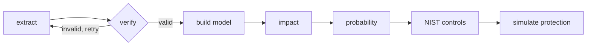

# CySyMo — Agentic AI for cyber risk modelling

Research internship project, **Kingston University London** (module CI7526 — Agentic AI & Cybersecurity, May–Sept 2026), supervised by **Prof. Eckhard Pfluegel**.

CySyMo turns a **free-text description of an IT system** into a quantified **cyber risk model**, then lets you test it with **attacker vs. defender AI agents**.

> **Principle: the AI proposes, the human validates, the engine computes.**
> LLM agents extract and suggest; every risk value is computed by a deterministic model.

---

## What it does

1. **Describe a system** in plain text (e.g. "a small clinic with an online booking site and a patient database").
2. **An LLM agent builds the risk model**: vulnerabilities, threats (OCTAVE profiles: actor, motive, access, outcome), assets, impact matrix, attack probabilities, and NIST SP 800-53 controls.
3. **The agent checks its own work**: a verification step rejects an inconsistent model and retries (max 3 attempts).
4. **The user reviews and edits** every element in the web interface before computing.
5. **The engine computes the risk** (mean, total or max aggregation), with history and CVE data from NVD.
6. **Attack scenarios and reports**: AI-proposed scenarios whose risk is recomputed by the engine; PDF, DOCX and HTML reports.
7. **Adversarial simulation**: an attacker agent and a defender agent play a 6-step kill chain, turn by turn, streamed live with their reasoning.
8. **Serious game** (work in progress): the same simulation played by students, with separate professor, attacker and defender views.

---

## The agent (LangGraph)



- `extractor.py`: 5 Claude prompts (extraction with OCTAVE profiles, impact, probability, NIST SP 800-53 controls, scenarios).
- `agent.py`: LangGraph `StateGraph` with a typed shared state and a self-verification loop.
- NIST catalogue used through a light index: the AI picks control IDs, Python loads the details locally.

## Risk model

The core engine `cysymo.py` (**Cyber System Risk Model, by Prof. Eckhard Pfluegel**) computes, for vulnerabilities *i* and threats *j*:

```
R = Σ e_i · A_ij · p_j / (m · n)      e = exposure, A = impact matrix, p = attack probability
```

My work is built **around** this engine without modifying it (`risk_formulas.py` adds total and max aggregation).

---

## Evaluation

Extraction quality measured against **hand-built references** on 4 system descriptions (online shop, clinic, water treatment plant, HR system), with manual matching (`eval/`):

| | Precision | Recall | F1 |
|---|---|---|---|
| **Overall** | 0.61 | **0.80** | 0.69 |
| Assets | 0.81 | 0.81 | 0.81 |
| Vulnerabilities | 0.64 | 0.84 | 0.73 |
| Threats | 0.46 | 0.75 | 0.57 |

Recall is the priority metric: in risk assessment, a missed threat costs more than an extra one the consultant removes.

---

## Project structure

| File | Role |
|---|---|
| `cysymo.py` | Risk engine (Prof. Pfluegel) |
| `extractor.py`, `agent.py` | LLM extraction and LangGraph agent |
| `risk_formulas.py` | Risk aggregation modes |
| `cve.py` | CVE lookup on the NVD API (CVSS) |
| `scenarios.py` | Attack scenarios, risk recomputed by the engine |
| `simulation.py`, `sim_report.py`, `sim_stats.py` | Attacker vs. defender simulation, debrief report, statistics |
| `game_engine.py` | Serious game (professor / attacker / defender) |
| `pdfreport.py` | PDF / DOCX / HTML reports |
| `database.py` | SQLite persistence, projects, history, backup / restore |
| `backend.py` | FastAPI backend |
| `static/index.html` | Web interface |
| `eval/` | Evaluation: descriptions, references, generated outputs, scoring |
| `Dockerfile`, `docker-compose.yml` | Container setup |

---

## Run it

```bash
python -m venv venv && source venv/bin/activate
pip install -r requirements.txt
echo "ANTHROPIC_API_KEY=..." > .env
uvicorn backend:app --reload --port 8000
# open http://127.0.0.1:8000
```

Or with Docker: `docker compose up`.

## Stack

Python · Claude API (Anthropic) · LangGraph · FastAPI · SQLite · NVD API · ReportLab · Docker · HTML/JS

---
Built by Amine Sabai. Risk engine `cysymo.py` by Prof. Eckhard Pfluegel.
